# DataPilot: Autonomous Multi-Agent Data Analyst

[](https://www.python.org/downloads/)
[](https://fastapi.tiangolo.com)
[](https://www.docker.com/)
[](https://streamlit.io/)
[](https://plotly.com/)

**DataPilot** is an autonomous data analytics platform that transforms raw tabular data into executive business intelligence. It pairs a multi-agent orchestration pipeline with an isolated Docker sandbox to safely plan, code, execute, self-heal, and synthesize verified statistical findings into an interactive dashboard.

---

## 🏗️ Architecture

```mermaid
flowchart LR
    A[("📄 CSV Dataset")] --> B["🧠 Planner Agent"]
    B --> C["⚡ Analyst Workers"]
    C -->|Run Code| D["🐳 Docker Sandbox"]
    D -->|Error / Retry| C
    D -->|Facts & Plotly Charts| E["🎯 Synthesizer Agent"]
    E --> F["📊 Streamlit Dashboard"]

    classDef default fill:#f8fafc,stroke:#64748b,stroke-width:1.5px;
    classDef nodeHighlight fill:#eff6ff,stroke:#2563eb,stroke-width:2px;
    classDef sandboxNode fill:#ecfdf5,stroke:#059669,stroke-width:2px;
    classDef uiNode fill:#fff7ed,stroke:#ea580c,stroke-width:2px;

    class B,C,E nodeHighlight;
    class D sandboxNode;
    class F uiNode;
```



---

## ⚡ Core Features

- **📁 25MB CSV Dataset Upload**: Upload tabular datasets up to 25 MB with automatic schema inspection and optional target column selection.
- **⚡ Parallel Multi-Worker Sub-Agents**: Dispatches analyst sub-agents concurrently across a sliding-window ThreadPool to write and test analytical code in parallel.
- **🐳 Isolated Docker Sandbox**: Safely runs generated Python scripts inside locked-down, ephemeral containers with non-root access and resource limits.
- **🔄 Autonomous Self-Healing**: Automatically catches runtime tracebacks or errors, prompting sub-agents to correct their code on the fly.
- **🎯 Actionable Executive Insights**: Synthesizes verified numerical findings into a clean business brief—delivering an overall Verdict, top drivers, and next steps without hallucinations.
- **📊 Native Plotly Visualizations**: Serializes interactive Plotly figures directly to the dashboard with zero-rerun client tabs.

---


## 🚀 Quickstart

### 1. Prerequisites
- **Python 3.12+** (via [`uv`](https://github.com/astral-sh/uv) or `pip`)
- **Docker Desktop** running locally
- **Groq** API key (or OpenAI API key)

### 2. Setup
```bash
# Clone the repository
git clone https://github.com/rajgurubhosale/DataPilot.git
cd DataPilot

# Install dependencies
uv sync

# Build the execution sandbox container
docker build -t sandbox:latest src/dataanalyst_agent/sandbox
```

### 3. Environment Variables
Add your API key to `.env`:
```env
GROQ_API_KEY=your_groq_api_key_here
```

### 4. Run the Platform
Start the backend and frontend in separate terminals:

```bash
# Terminal 1: FastAPI Backend
uv run python -m dataanalyst_agent.backend.main

# Terminal 2: Streamlit Dashboard
uv run streamlit run src/dataanalyst_agent/frontend/app.py
```

Open `http://localhost:8501`, upload your dataset (CSV up to 25 MB), and view your automated executive analysis.
